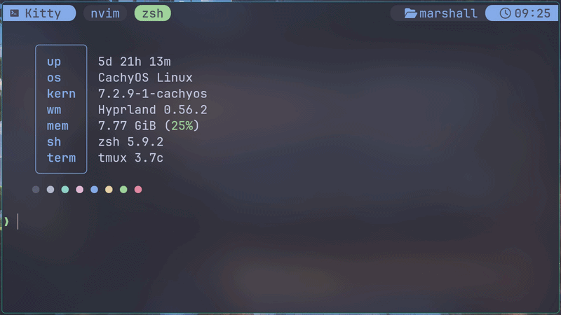

# ptt

Push to talk voice typing on Wayland. Offline Whisper on an NVIDIA GPU,
words typed live at the cursor.



## Requirements

- NVIDIA GPU. GTX 10xx needs `nvidia-580xx`.
- Wayland compositor with virtual keyboard: Hyprland, sway. Not GNOME.
- `wtype`, `pipewire`, `uv`, `gcc`.
- Optional: `swayosd` popup, Hyprland 0.55+ border, `sound-theme-freedesktop` sounds.

## Install

```bash
git clone https://github.com/shalom2552/ptt.git
cd ptt && ./install
```

Installs packages with pacman, adds the account to `input`, downloads the
model (1.6 GB) and starts the service. Log out and back in after. The install
links to the clone, so keep it in place.

Uninstall: `./install --uninstall` from the clone.

## Usage

Bind Pause to nothing so apps ignore it. Hyprland:

```lua
hl.bind("Pause", hl.dsp.exec_cmd("true"))
```

Hold Pause and talk. Release to finish.

- Config: `~/.config/ptt/config.toml`
- Names and jargon: `~/.config/ptt/words.txt`
- Apply changes: `systemctl --user restart ptt`
- Log: `journalctl --user -u ptt -f`

## Troubleshooting

- Key does nothing: `id` must list `input`. Log out and back in.
- Wrong mic: `wpctl set-default <id>`
- Missing `libcublas` or `libcudnn`: run `./install` again.

## License

MIT
